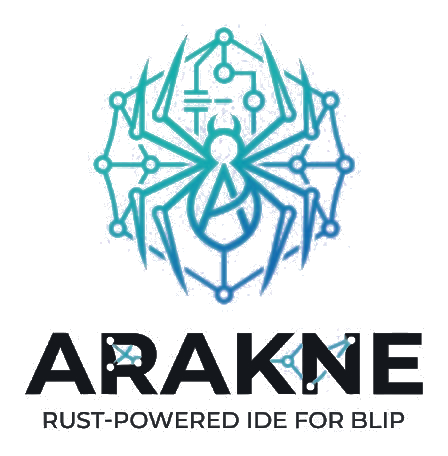

<p align="center">
  <picture>
    <source media="(prefers-color-scheme: dark)" srcset="assets/logo-dark.png">
    
  </picture>
</p>

<p align="center">
  <strong>The desktop IDE for building and maintaining Blip Builder flows.</strong>
</p>

<p align="center">
  <a href="https://github.com/wellrcosta/arakne-releases/releases/latest"></a>
  
  
  <a href="LICENSE"></a>
</p>

<p align="center">
  <a href="https://github.com/wellrcosta/arakne-releases/releases/latest"><strong>Download the latest release</strong></a>
</p>

---

## About this repository

This repository is the public distribution channel for Arakne. It holds the installers and release
notes; the source code is developed in a separate private repository.

## What is Arakne?

Arakne brings everything needed to work on Blip flows into one fast, native application. It is not a
general-purpose editor: every feature is designed around Blip.

| | |
|---|---|
| **Visual canvas** | Navigate and edit flows, blocks and their components |
| **Code editor** | Work on scripts and project files with syntax highlighting and autocomplete |
| **Script tests** | Run and test Builder scripts without leaving the app |
| **HTTP requests** | Build and send requests next to the flows that use them |
| **API contracts** | Create and document OpenAPI contracts alongside your project |
| **Analysis** | Find flow problems and track variables across a project |
| **Git** | Review changes and work with your repositories from inside the app |
| **Blip publishing** | Publish directly to Blip, per bot and per environment |

### Built for daily use

- **Native performance:** written in Rust and rendered on the GPU, with no webview.
- **Open project format:** a project is a plain folder, and flows stay as raw Builder JSON.
- **Protected credentials:** keys and tokens are stored encrypted, outside every project folder.
- **Multilingual:** available in English, Brazilian Portuguese and Spanish.

## Download

Get the file for your system from the [latest release](https://github.com/wellrcosta/arakne-releases/releases/latest).

| System | File |
|---|---|
| Windows (x64) | `Arakne-<version>-windows-x64-setup.exe` |
| macOS (Intel and Apple Silicon) | `Arakne-<version>-macos.dmg` |
| Ubuntu / Debian (x86_64) | `arakne_<version>-1_amd64.deb` |
| Fedora (x86_64) | `arakne-<version>-1.x86_64.rpm` |
| Arch Linux (x86_64) | `arakne-<version>-1-x86_64.pkg.tar.zst` |

[Git](https://git-scm.com/downloads) must be installed on your machine.

## Installation

Arakne's installers are not yet signed with Windows or Apple developer certificates, so both
systems show a warning the first time.

<details>
<summary><strong>Windows</strong></summary>

1. Run the `-setup.exe` file. It installs for your user only and does not require administrator rights.
2. If SmartScreen appears, select **More info**, then **Run anyway**.

</details>

<details>
<summary><strong>macOS</strong></summary>

1. Open the `.dmg` and drag **Arakne** to **Applications**.
2. Open Arakne. If macOS blocks it, go to **System Settings → Privacy & Security** and select **Open Anyway**.

Requires macOS 11 or later.

</details>

<details>
<summary><strong>Linux</strong></summary>

Run the command for your distribution from the folder containing the downloaded file:

```sh
# Ubuntu / Debian
sudo apt install ./arakne_<version>-1_amd64.deb

# Fedora
sudo dnf install ./arakne-<version>-1.x86_64.rpm

# Arch Linux
sudo pacman -U arakne-<version>-1-x86_64.pkg.tar.zst
```

</details>

## License

Arakne is proprietary software. Copyright © 2026 Wellington Reis. All rights reserved.

Public availability of these files does not grant a license: use requires a written agreement with
the owner. See [LICENSE](LICENSE) ([Brazilian Portuguese version](LICENSE.pt-BR)).
